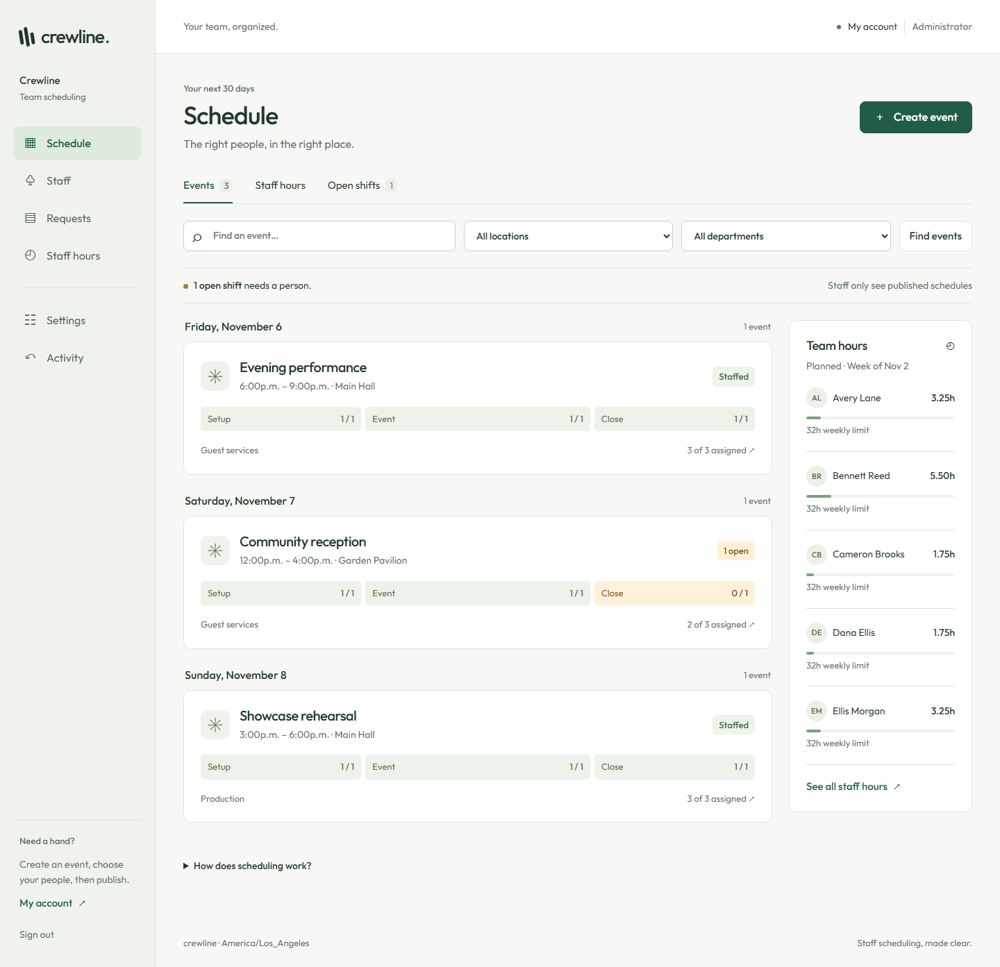

# Crewline

[Source: jrquigley/crewline](https://github.com/jrquigley/crewline) · [Deployment](docs/DEPLOYMENT.md) · [Claude / Codex handoff](docs/HANDOFF.md) · [Full roadmap](docs/ROADMAP.md)

Event staff scheduling for multiple departments and locations. A calm desktop workspace helps managers create Events, choose qualified people, check hours and publish. Staff get a simple phone screen with their next shift, upcoming schedule and time-off request.

**Version 1.0.0: functioning server application with authentication and persistent data.** Intended host: `https://shifts.quigspace.com`. Repository upload does not deploy the owner's server. Start with synthetic data and follow the deployment/pilot checks before using real staff.



## Run with Docker

```sh
git clone https://github.com/jrquigley/crewline.git
cd crewline
cp .env.example .env
# Edit .env: set your real ADMIN_EMAIL and a unique ADMIN_PASSWORD (15+ characters).
docker compose up -d --build
docker compose logs --tail 50 crewline
```

Put your HTTPS reverse proxy in front of `127.0.0.1:3000`, forwarding `Host` and `X-Forwarded-Proto: https`. Sign in at your configured `APP_BASE_URL`. The default is `https://shifts.quigspace.com`. See the [full first-start, proxy, update, backup and recovery instructions](docs/DEPLOYMENT.md), including container-network alternatives. No default administrator password exists.

The named `/data` volume retains the SQLite database and generated secret across container replacements. **Keep this volume and its secret.** One container serves one organization; horizontal replicas and a network-mounted SQLite database are unsupported.

## Included

- Secure sessions, CSRF protection, throttled sign-in, one-use invitations and password recovery; verified changes to sign-in email require the current password.
- Admin, scoped managers and staff; departments, locations, skills, staff records and weekly limits.
- Arbitrary-date Events, setup/Event/closing coverage, additional departments and headcounts, overlapping handovers, shift splitting, assignment checks and hours CSV.
- Drafts remain private until publication. Conflict checks run on the server and again during publication or open-shift approval.
- Staff next shift, personal/team schedule, time off, recurring/date availability, contact information, open-shift requests and calendar setup.
- Employment termination revokes sessions, invitations and calendar tokens, cancels pending delivery, reopens future shifts and retains history.
- SMTP outbox, published-shift updates and a configurable next-week email. Without SMTP, email remains disabled; private invites can be shared manually.
- Private revocable iCalendar subscriptions and Google/Android/iPhone/Outlook instructions; separate add-to-home-screen guidance.
- Five fictional employees created once: Avery Lane, Bennett Reed, Cameron Brooks, Dana Ellis and Ellis Morgan. They have no usable passwords until individually invited. Fictional addresses are blocked from delivery.

## Current boundaries

This is a small-team pilot release. Live external Event imports, skill expiry, rehire automation, time clock/payroll, SSO/MFA, multi-tenant billing and native apps remain roadmap work. External Event context is currently a manual manager note. Scheduled hours are planning totals, with no payroll or legal-policy engine. Actual email-provider delivery, phone calendar clients, production TLS, backup restoration and manager/staff acceptance must be verified on the owner's deployment.

## Develop and verify

Python 3.12+ (Docker/CI use 3.13):

```sh
python -m venv .venv
# Activate .venv for your shell, then:
python -m pip install -r requirements.txt
python app/manage.py collectstatic --noinput
python app/manage.py check
python app/manage.py test scheduling --noinput
```

[Testing](docs/TESTING.md) describes the real browser, accessibility, security, concurrency and Docker checks. [Design review](docs/DESIGN-REVIEW.md) records Taste application, screenshots and tool limitations. The earlier Node interface preview remains under `prototype/`, `public/` and `server/`; `npm start` now starts the Django service, while `npm run preview` runs the archived sample preview.

## Documentation and shared work

Start with [START-HERE](docs/START-HERE.md), [HANDOFF](docs/HANDOFF.md), [ROADMAP](docs/ROADMAP.md), [REQUIREMENTS](docs/REQUIREMENTS.md), [ARCHITECTURE](docs/ARCHITECTURE.md), [DATA-MODEL](docs/DATA-MODEL.md), [DECISIONS](docs/DECISIONS.md), [WORKLOG](docs/WORKLOG.md), [TESTING](docs/TESTING.md) and [DEPLOYMENT](docs/DEPLOYMENT.md). Contributors follow [AGENTS.md](AGENTS.md); [CLAUDE.md](CLAUDE.md) uses the same agreement. No Claude or independent security review is claimed. No project license has been selected; font licensing is included beside the font.
